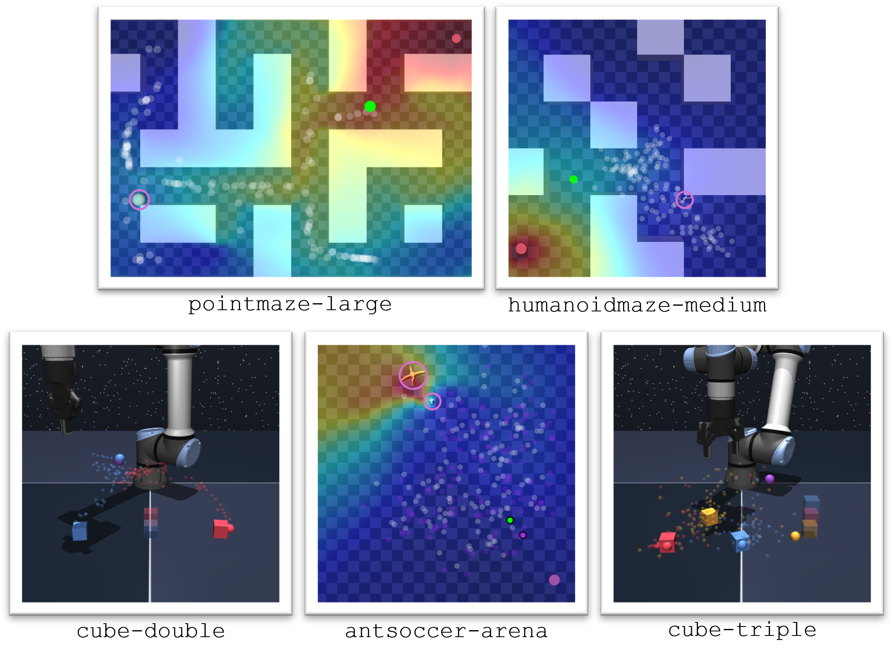

# Temporally-extended Latent Action World Models (Te-LAWM)

Official PyTorch code release of the paper "*Hierarchical Reinforcement Learning with Temporally-Extended Latent Action World Models*" by Dan Haramati, Chandradithya S Jonnalagadda, Akhil Bagaria and George Konidaris.

This repository is PyTorch-based and uses torch.compile and CUDA graphs for acceleration.

<h1 align="center">
  <br>
	Hierarchical Reinforcement Learning with Temporally-Extended Latent Action World Models
  <br>
</h1>
  <h3 align="center">
    <a href="https://danhrmti.github.io/">Dan Haramati</a> •
    <a href="https://chandradithyaj.github.io/">Chandradithya S Jonnalagadda</a> •
    <a href="https://abagaria.github.io/">Akhil Bagaria</a> •
    <a href="https://cs.brown.edu/people/gdk/">George Konidaris</a>
  </h3>

<h3 align="center">In Submission</h3>
<h4 align="center">Model-Based RL in the Era of Generative World Models Workshop at RLC 2026 - Best Paper</h4>

<h3 align="center">
    <a href="">arXiv</a> •
    <a href="https://openreview.net/forum?id=2SwshSxGPH">OpenReview (Workshop Version)</a>
</h3>

<p align="center">
  
</p>

> **Abstract**
>
> *World Models enable counterfactual reasoning and planning but struggle in long horizon tasks because prediction errors compound over the horizon. Temporal abstraction can mitigate these errors by simply requiring fewer consecutive predictions for a given horizon. We propose a Temporally-extended Latent Action World Model (Te-LAWM) and present a hierarchical model-based framework for goal-conditioned reinforcement learning that leverages it to generate subgoals for a value-based model-free policy. Our temporally-extended latent action model learns a multi-step action abstraction, a multi-step dynamics model conditioned on these abstract actions (the Te-LAWM), and a prior policy over the actions within a single objective. Subgoal planning is done by rolling out the prior policy within the Te-LAWM. We demonstrate superior performance of our framework compared to flat model-based and hierarchical model-free approaches on benchmark navigation and manipulation tasks. Ablations show that autoregressive subgoal generation allows the agent to stitch together experience from different trajectories, and that temporal action abstraction is essential for scaling world model predictions to long horizons and large action spaces.*

## Citation
Please consider citing our work if you find our paper or this repository useful.
<!-- >
    TODO: BibTeX -->

### Content

1. [Prerequisites and Environment Installation](#1-prerequisites-and-environment-installation)
2. [Environments and Datasets](#2-environments-and-datasets)
3. [Methods](#3-methods)
4. [Training](#4-training)
5. [Evaluation](#5-evaluation)
6. [Repository Content Summary](#6-repository-content-summary)
7. [Credits](#7-credits)

## 1. Prerequisites and Environment Installation

The following are the main libraries required to run this code:

| Library      | Version  |
|--------------|----------|
| `python`     | `3.10`   |
| `pytorch`    | `2.10.0` |
| `tensordict` | `0.11.0` |
| `torchrl`    | `0.11.1` |
| `ogbench`    | `1.2.1`  |

For the full list of requirements, see the `requirements.txt` file:
```
conda create -n telawm python=3.10
conda activate telawm
pip install -r requirements.txt
```

Rendering (evaluation videos and pixel observations) uses MuJoCo with the EGL backend, which requires a GPU.

## 2. Environments and Datasets

We use tasks from the [OGBench](https://github.com/seohongpark/ogbench) benchmark:

| Domain         | Tasks                                                         |
|----------------|---------------------------------------------------------------|
| `pointmaze`    | `{medium, large}-{navigate, stitch}`                          |
| `antmaze`      | `{medium, large}-{navigate, stitch}`                          |
| `humanoidmaze` | `{medium, large}-{navigate, stitch}`                          |
| `antsoccer`    | `arena-{navigate, stitch}`, `medium-navigate`                 |
| `cube`         | `{single, double, triple}-{play, noisy}`                      |
| `scene`        | `play`, `noisy`                                               |
| `visual-antmaze` (pixels) | `medium-navigate`, `medium-stitch`, `large-navigate` |

Task names follow OGBench, e.g. `task=antmaze-large-navigate-v0`.

The OGBench datasets are downloaded automatically on first use to `datasets/data` (`data_dir` in `config.yaml`).

>Notice that when training an agent on autoencoder latents (`obs=latent`) for the first time, the entire visual dataset is encoded with the autoencoder and saved as a separate copy in the data folder, which is used directly by subsequent runs with the same autoencoder. For that first run, expect high memory usage and initial processing time.

## 3. Methods

| Agent (`agent=`) | Description |
|------------------|-------------|
| `telawm`         | **Te-LAWM (ours)**: generates subgoals by rolling out a prior policy over temporally-extended latent actions in the Te-LAWM, for an IQL low-level policy |
| `iql`            | Goal-conditioned implicit Q-learning; also provides the frozen value function and low-level policy to other methods |
| `tdmpc`          | TD-MPC-style planning with a learned world model |
| `saw`            | Subgoal-advantage-weighted policy bootstrapping |
| `hiql`           | Hierarchical IQL |
| `sd`             | Subgoal Diffuser |
| `acwm`, `lacwm`  | Action-chunk and latent action-chunk world models (ablations) |
| `ae`             | Image autoencoder for the visual tasks |

The Te-LAWM ablations (fixed prior, single-step planning) are `agent=telawm` with the corresponding arguments; see `commands_train.sh`.

## 4. Training

Train agents using `train.py`. See `commands_train.sh` for the commands of every experiment in the paper, one line per task and method, with the seeds as shell variables:
```
SEED=1 IQL_SEED=0
python train.py task=antmaze-large-navigate-v0 agent=telawm ... telawm.vf_chkpt=output/train/iql_antmaze-large-navigate-v0_${IQL_SEED}/models/latest.pt ... seed=${SEED}
```

All methods except IQL use a frozen pretrained IQL agent of the same task, so train the IQL agent of a task first and pass its seed as `IQL_SEED`. On the visual tasks, train the autoencoder first (`AE_SEED`). SD and Te-LAWM then train on autoencoder latents and are evaluated from pixels with the `evaluate.py` line that follows their training line.

Log training statistics and videos using [Weights & Biases](https://wandb.ai/site) by filling in `wandb_project` and `wandb_entity` in `config.yaml`, or disable it with `enable_wandb=false`.

Agent model checkpoints and wandb data (if enabled) are saved in `output/train/<agent>_<task>_<seed>[_<run_suffix>]`.

## 5. Evaluation

Evaluate agents using `evaluate.py`. See `commands_eval.sh` for the evaluation command of every experiment in the paper.

Results are saved in `output/eval/`.

## 6. Repository Content Summary
| Filename      | Description                                                       |
|---------------|-------------------------------------------------------------------|
| `agents/`     | agents and architectures (latent action models, world models, diffusion) |
| `assets/`     | images and GIFs for this README                                   |
| `commands_train.sh` | training commands of all experiments in the paper         |
| `commands_eval.sh`  | evaluation commands of all experiments in the paper       |
| `common/`     | trainer, data buffer, OGBench wrapper and utils                   |
| `config.yaml` | config file for training and evaluation                           |
| `evaluate.py` | main evaluation script                                            |
| `train.py`    | main training script                                              |

## 7. Credits
* Environments and datasets are from [OGBench](https://github.com/seohongpark/ogbench)
* Agent code written in PyTorch modified from [LeanRL](https://github.com/meta-pytorch/LeanRL)
* IQL and HIQL are based on the [OGBench](https://github.com/seohongpark/ogbench) implementations
* SAW is based on the [official SAW repository](https://github.com/johnlyzhou/saw)
* TD-MPC adapts some of the code from the [official TD-MPC2 repository](https://github.com/nicklashansen/tdmpc2)
